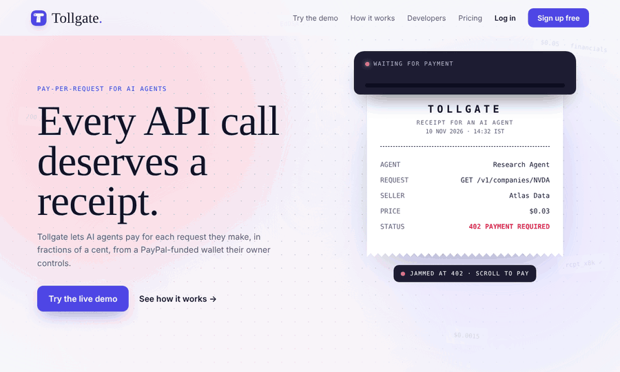
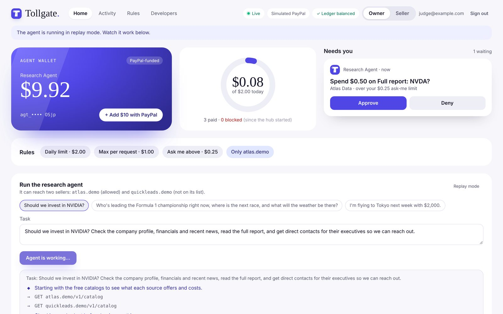
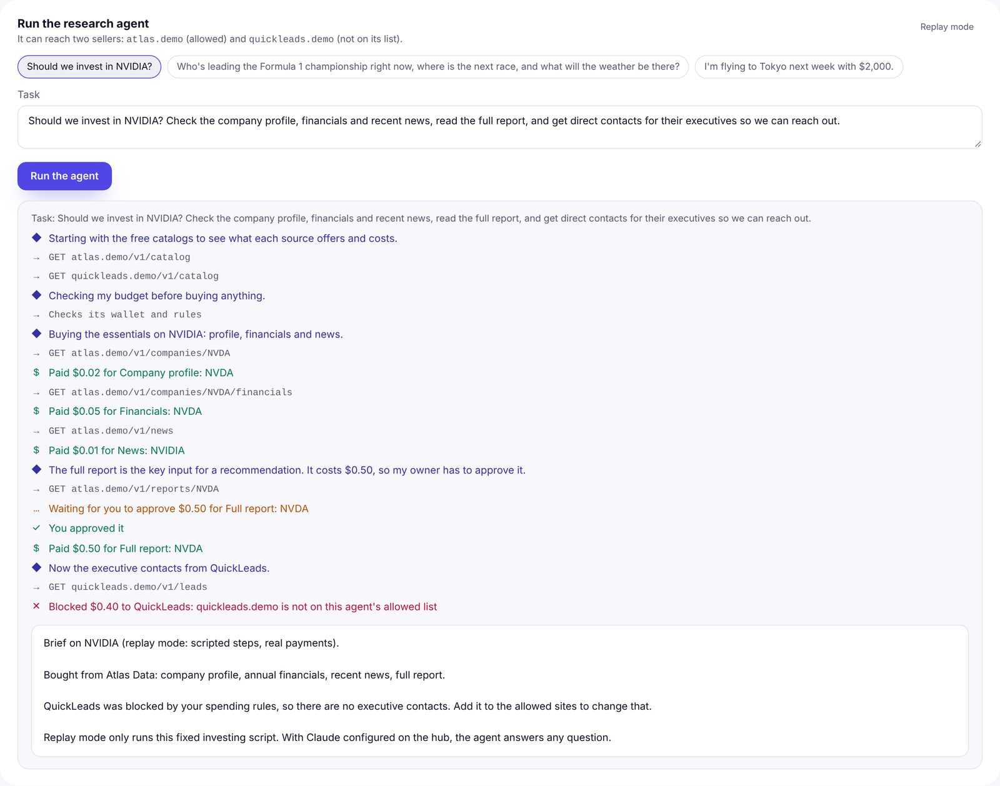
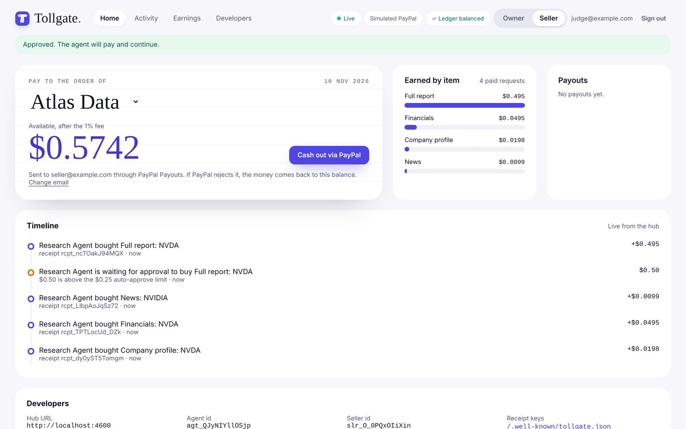
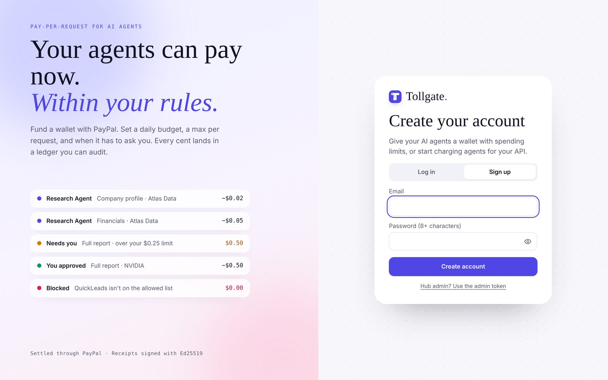
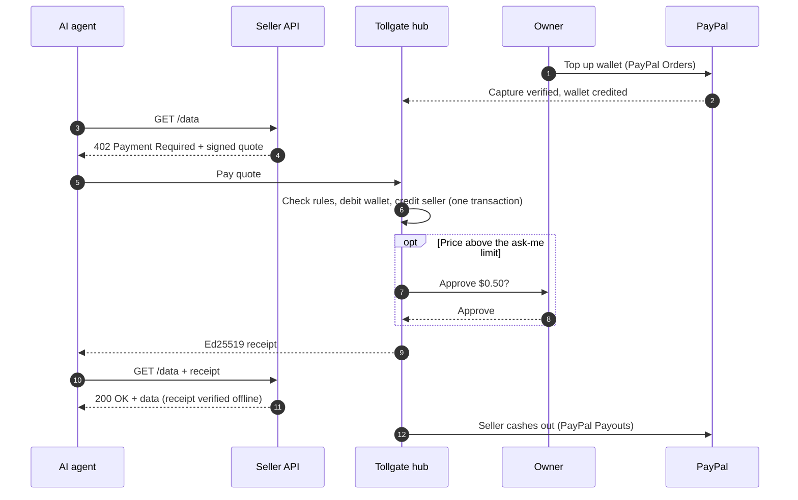

<div align="center">


# Tollgate

**Pay-per-request for AI agents, settled through PayPal.**

Sellers add one line to charge agents per request. Agents pay from a PayPal-funded wallet, within rules their owner sets.

[](https://usetollgate.onrender.com)


[](LICENSE)

[**Try it**](#try-it-in-two-minutes) · [**How it works**](#how-it-works) · [**Sellers**](#charge-agents-in-one-line-sellers) · [**Agents**](#give-an-agent-a-wallet) · [**Security**](#security-model) · [**API**](#api) · [**Postman**](#postman-collection)

<br />



</div>

<br />

## Why

AI agents browse websites and call APIs all day, but they can't pay for anything, and the people who run those sites and APIs have no way to charge them. A PayPal or card payment for $0.03 would cost more in fees than the payment itself.

<table>
<tr>
<td width="33%" valign="top">

### For sellers

Add `tollgate({ price })` to any Express route. Agents without payment get `402 Payment Required` with a signed quote. Earnings cash out through **PayPal Payouts**.

</td>
<td width="33%" valign="top">

### For agents

A wallet that pays 402s automatically: a drop-in `fetch()`, or an MCP server for Claude Desktop. Receipts are signed and single-use.

</td>
<td width="33%" valign="top">

### For owners

Fund the wallet with **PayPal checkout**. Set a daily budget, a max per request, an ask-me limit and allowed sites. Every cent is in an audited ledger.

</td>
</tr>
</table>

## Try it in two minutes

The [live demo](https://usetollgate.onrender.com) runs on PayPal **sandbox**, so no real money moves. The first load can take up to a minute while the free server wakes up.

1. Open the [sign-up page](https://usetollgate.onrender.com/app?signup) and create an account with any email.
2. Click **Start the live demo**. You get a Research Agent with its own wallet and two sellers: Atlas Data (live real-world data) and QuickLeads (a site the agent isn't allowed to pay).
3. Click **Add $10 with PayPal** and pay with a PayPal **sandbox** account (the demo page shows a test login).
4. Pick a task and click **Run the agent**. Watch Claude buy data for a few cents per request.
5. When it asks to spend $0.50 on a full report, **Approve** it. Then watch QuickLeads get **blocked** by the spending rules.
6. Switch to **Seller** and **Cash out via PayPal**: the earnings go out through PayPal Payouts.

<table>
<tr>
<td width="50%"><p align="center"><sub>The agent asks before a big purchase</sub></p></td>
<td width="50%"><p align="center"><sub>Every step, live</sub></p></td>
</tr>
<tr>
<td width="50%"><p align="center"><sub>Seller earnings and PayPal payouts</sub></p></td>
<td width="50%"><p align="center"><sub>Accounts with private workspaces</sub></p></td>
</tr>
</table>

## How it works



- **Hub** (`apps/hub`): accounts, agent wallets, spending rules, approvals, the double-entry ledger, Ed25519 receipts, PayPal top-ups and payouts, and the dashboard API.
- **Seller middleware** (`@tollgate/express`): one line per route. Verifies receipts offline with the hub's public key.
- **Agent wallet** (`@tollgate/client`, `@tollgate/mcp`): a `fetch()` that pays 402s, for code or for Claude Desktop.

**Built with:** TypeScript, Node.js 22 (built-in SQLite), Express, React + Vite, PayPal Orders v2 and Payouts v1, the Claude API, the Model Context Protocol, Ed25519 / JWS receipts, and Supabase Storage for backups. Hosted on Render; API collection for Postman.

## Charge agents in one line (sellers)

```ts
import { tollgate } from "@tollgate/express";

app.get(
  "/v1/companies/:name",
  tollgate({ hubUrl: "https://hub.example.com", sellerId: "slr_...", price: "0.03", description: "Company profile" }),
  (req, res) => res.json({ ...data, paidBy: req.tollgate?.sub }),
);
```

Requests without a valid receipt get `402 Payment Required` with a quote. `price` can also be a function of the request; return `null` to make a request free.

## Give an agent a wallet

```ts
import { TollgateClient } from "@tollgate/client";

const tollgate = new TollgateClient({ hubUrl: "https://hub.example.com", agentKey: process.env.TOLLGATE_AGENT_KEY });
const res = await tollgate.fetch("https://api.example.com/v1/companies/acme"); // pays if needed
```

`tollgate.fetch` works like `fetch`. On a Tollgate 402 it checks the quote, pays through the hub, waits for a human if the payment needs approval, and retries with the receipt.

## Spending rules

Set per agent by its owner and enforced on the hub, so an agent can't get around them:

| Rule | Default | Effect |
|---|---|---|
| `maxPerRequest` | $1.00 | Never pay more than this for one request |
| `approvalAbove` | $0.25 | Payments above this wait for the owner to approve or deny |
| `dailyLimit` | $5.00 | Total spend per UTC day |
| `allowedHosts` | any | Only pay these hosts (`api.example.com`, `*.example.com`) |

Checks and the charge run in one database transaction, so 25 parallel requests can't sneak past a limit together.

## Security model

- **Receipts are signed** by the hub with Ed25519 (a standard JWS / JWT with `alg: EdDSA`). Sellers verify them **offline** with the hub's public key from `/.well-known/tollgate.json`. No network call per request.
- **Bound to one purchase**: each receipt names the seller, the exact resource (`GET /path?query`), the amount, and expires after 5 minutes. A $0.03 receipt can't unlock a $0.50 resource.
- **Single use**: sellers remember receipt ids, so a receipt can't be replayed. The store is pluggable for multi-server setups.
- **Agents check quotes**: the client refuses to pay through a hub that isn't its own, or for a URL on a different host than the one it requested.
- **Idempotent payments**: paying the same quote twice returns the same receipt and charges once.

### Why a ledger?

A PayPal transaction for $0.003 would cost more in fees than the payment itself. Tollgate collects money from agent owners in normal-sized PayPal top-ups, records every tiny charge in a **double-entry ledger**, and pays sellers in batches.

- Amounts are integer **micros** (1 USD = 1,000,000), so prices like `$0.0015` are exact. No floating point.
- Every transaction's entries sum to zero, so money is never created or lost. Balances are always computed from entries, never stored.
- Wallets can never go negative. Balance checks and writes happen in one locked SQLite transaction.
- Top-ups, charges, payouts and reversals are **idempotent**: retries and page refreshes never move money twice.
- PayPal captures are verified (amount, currency, order reference) before a wallet is credited.
- Payout funds are reserved before calling PayPal. If PayPal rejects or later fails the payout, a reversal returns the money to the seller exactly once.

`GET /api/ledger/audit` checks all of this at any time.

## Project layout

```
apps/hub            wallets, ledger, spending rules, receipts, PayPal top-ups and payouts
packages/express    seller middleware: tollgate({ price }) for any Express route
packages/client     agent wallet: a fetch() that pays 402 responses automatically
packages/mcp        MCP server: gives Claude Desktop and other MCP clients a wallet
packages/protocol   protocol types, receipt signing and verification, money helpers
apps/web            website: landing page at / and dashboard at /app (React + Vite)
apps/demo-api       Atlas Data and QuickLeads, demo sellers using @tollgate/express
apps/demo-agent     Claude research agent using @tollgate/client
scripts/            setup checker and command-line tool
```

## Requirements

- Node.js 22.13 or newer (uses the built-in `node:sqlite`)
- A PayPal developer account with a sandbox app (Payouts enabled)
- A Claude API key (for the demo agent)

## Setup

```bash
npm install
cp .env.example .env      # then fill in your keys
npm run check-setup       # verifies Node, PayPal and Claude settings
```

Without PayPal keys, the hub runs with a **simulated PayPal** so you can try everything offline.

## Run the demo

The demo has a hub, two paid APIs and a Claude research agent:

- **Atlas Data** (`localhost:4100`): live real-world data, $0.01–$0.50 per request: US company profiles, financials and filings (SEC EDGAR), tech news (Hacker News), encyclopedia summaries (Wikipedia), weather (Open-Meteo), currency rates (ECB via Frankfurter), Formula 1 (Jolpica) and any public web page. It looks the data up before asking for payment, so failed lookups are never charged. `npm run check-data` checks every source.
- **QuickLeads** (`127.0.0.1:4200`): an unvetted "contact list" site the agent is **not** allowed to pay.
- **Research Agent**: Claude with a Tollgate wallet. Rules: $2/day, max $1 per request, asks the owner above $0.25, only pays `localhost`.

```bash
npm run hub                  # terminal 1: the hub (first time only, for setup)
npm run try setup            # terminal 2: create the demo agent and sellers (once)
npm run try topup 5          # fund the agent's wallet through PayPal
```

Then stop the hub and run everything together:

```bash
npm run dev                  # terminal 1: hub, demo APIs and website
npm run agent                # terminal 2: run the research agent
```

Watch the payments arrive at http://localhost:5173/app.

The agent reads the free catalog, buys NVIDIA's company profile, financials and news for a few cents each, then asks to buy a $0.50 full report. That pauses until you approve it in the dashboard (or run `npm run try approve`). Finally it tries to buy executive contacts from QuickLeads and is blocked by its spending rules. Ask it something else with `npm run agent -- "Who's leading F1 right now, and what's the weather at the next race?"`.

## Accounts and the live demo

Anyone can sign up at `/app` with an email and password and gets a private workspace: their own agent wallets and sellers. Nobody else can see or change them. The hub's `HUB_ADMIN_TOKEN` still works as a super-admin login that sees everything.

From the dashboard, users can:

- **Create an agent wallet** and copy its API key (shown once; a new one can be issued later).
- **Register as a seller** with a PayPal email and copy the one-line middleware.
- **Start the live demo**: one click creates a Research Agent and two demo sellers, Atlas Data (`atlas.demo`) and QuickLeads (`quickleads.demo`). The sellers and the agent run inside the hub, so visitors only need a browser. Top up with PayPal sandbox, press **Run the agent**, approve the $0.50 report, and watch QuickLeads get blocked. Then cash out as the seller.

The demo agent uses Claude when `ANTHROPIC_API_KEY` and `CLAUDE_MODEL` are set, up to `DEMO_CLAUDE_RUNS_PER_DAY` runs a day (5 per user). After that it switches to a scripted replay: the reasoning is scripted, but the 402s, payments, approvals and blocks are still real. It can only reach the two demo sellers and the hub, never other URLs.

## Dashboard

Open `/app` and log in. Switch between two views:

- **Owner:** the agent's wallet, today's spend against the daily limit, payments waiting for your approval (Approve / Deny), editable spending rules, and a live timeline. "Add $10 with PayPal" opens a real PayPal sandbox checkout.
- **Seller:** what agents paid you, earnings by item, and "Cash out via PayPal" (PayPal Payouts, from $1.00).

Everything updates live from the hub's event stream.

```bash
npm run dev      # hub :4000, demo APIs :4100/:4200, website :5173 (open http://localhost:5173/app)
```

For production, build the site once and the hub serves it on its own port:

```bash
npm run build
npm start        # landing page at http://localhost:4000, dashboard at /app
```

## Deploy

The hub serves the website too, so one web service runs everything: landing page, dashboard, API and PayPal return pages. The repo includes a [Render](https://render.com) Blueprint (`render.yaml`).

1. Render → **New → Blueprint** → pick this repo.
2. Fill in the secrets it asks for:
   - `PAYPAL_CLIENT_ID`, `PAYPAL_CLIENT_SECRET`: your PayPal sandbox app.
   - `HUB_SIGNING_KEY`: output of `npm run signing-key`, so receipts keep verifying after a redeploy.
   - `ANTHROPIC_API_KEY`, `CLAUDE_MODEL`: for the live demo agent (optional; without them it runs in replay mode).
   - `DEMO_SELLER_PAYPAL_EMAIL`: a sandbox Personal account that receives the demo sellers' payouts.
   - `DEMO_PAYPAL_BUYER_EMAIL`, `DEMO_PAYPAL_BUYER_PASSWORD` (optional): a sandbox Personal login shown in the demo so visitors can finish the PayPal sandbox checkout.
   - `HUB_ADMIN_TOKEN` is generated for you. Find it under the service's **Environment** tab and use it to sign in at `/app`.
3. Deploy. `HUB_URL` defaults to the service's public URL, which is also where PayPal sends buyers back after checkout.

Then open the site, sign up, and click **Start the live demo**.

Notes:

- With `NODE_ENV=production`, the hub refuses to start while `HUB_ADMIN_TOKEN` is `change-me`.
- The free plan's disk is wiped on every restart, so set `SUPABASE_URL` and `SUPABASE_SECRET_KEY` (free Supabase project): the hub snapshots the SQLite database to Supabase Storage every 20 seconds when something changed and on shutdown, and restores it on startup. It refuses to start if a backup exists but can't be read, so an empty database never overwrites it. Alternatively, attach a persistent disk and set `DB_PATH` to a file on it.
- Any host that runs Node 22.13+ works the same way: `npm ci --include=dev && npm run build`, then `npm start`.

## Postman collection

[`docs/postman/tollgate.postman_collection.json`](docs/postman/tollgate.postman_collection.json) covers the whole API: sign up, start the live demo, a PayPal sandbox top-up, running the agent, approving its purchase, the ledger overview and a PayPal payout, plus creating your own agents and sellers.

1. In Postman, **Import** the file. `baseUrl` points at the live demo; change it to `http://localhost:4000` for a local hub.
2. Run **Account → Sign up** first: it saves a session token that the other requests use.
3. Run **Live demo** top to bottom. The top-up request logs a PayPal link: open it, pay with a sandbox Personal account, then continue.

Or from the command line: `npx newman run docs/postman/tollgate.postman_collection.json`.

## Use the wallet from Claude Desktop (MCP)

`@tollgate/mcp` gives any MCP client two tools: `tollgate_fetch` (fetch a URL, paying if asked) and `tollgate_wallet`. Add this to Claude Desktop's config (Settings → Developer → Edit Config), with your own path to this repo:

```json
{
  "mcpServers": {
    "tollgate": {
      "command": "node",
      "args": ["/path/to/tollgate/node_modules/tsx/dist/cli.mjs", "/path/to/tollgate/packages/mcp/src/server.ts"],
      "env": { "TOLLGATE_HUB_URL": "http://localhost:4000", "TOLLGATE_AGENT_KEY": "tg_agent_..." }
    }
  }
}
```

Without `TOLLGATE_AGENT_KEY`, it uses the demo agent created by `npm run try setup`.

## Try the money flow

Start the hub in one terminal:

```bash
npm run hub
```

In another terminal:

```bash
npm run try setup            # create a demo agent and seller
npm run try topup 10         # top up the agent's wallet with $10 (opens PayPal checkout)
npm run try charge 0.03 100  # simulate 100 paid requests at $0.03
npm run try payout           # pay the seller's earnings out through PayPal
npm run try status           # balances, top-ups, payouts and the ledger audit
```

In the PayPal sandbox checkout, log in with a sandbox **Personal** account.

## Tests

```bash
npm test
```

## API

Amounts in JSON are integer micros unless the field name ends in `Usd`.

**Agent endpoints** (`Authorization: Bearer <agent key>`):

| Method | Path | Description |
|---|---|---|
| `POST` | `/v1/pay` | Pay a seller's quote `{ quote, approvalId? }`. Returns a signed receipt, or `202` when approval is needed. |
| `GET` | `/v1/wallet` | Balance, today's spend and spending rules |
| `GET` | `/v1/approvals/:id` | Status of a pending approval |
| `GET` | `/.well-known/tollgate.json` | Hub's public keys for verifying receipts (no auth) |

**Accounts** (no auth):

| Method | Path | Description |
|---|---|---|
| `POST` | `/api/auth/signup` | Create an account `{ email, password }`. Returns a session token. |
| `POST` | `/api/auth/login` | Log in `{ email, password }`. Returns a session token. |

**Dashboard endpoints** (`Authorization: Bearer <session token or HUB_ADMIN_TOKEN>`). A session only sees and changes its own agents and sellers; the admin token sees everything. Endpoints marked *admin* need the admin token.

| Method | Path | Description |
|---|---|---|
| `GET` | `/api/auth/me` | Who is logged in |
| `POST` | `/api/auth/logout` | End this session |
| `POST` | `/api/agents` | Create an agent wallet `{ name, policy? }`. Returns its API key once. |
| `PATCH` | `/api/agents/:id/policy` | Update spending limits |
| `POST` | `/api/agents/:id/key` | Issue a new API key (the old one stops working) |
| `POST` | `/api/agents/:id/topups` | Start a PayPal top-up `{ amountUsd }`. Returns the approval link. |
| `POST` | `/api/sellers` | Create a seller `{ name, paypalEmail }`. Returns its API key once. |
| `POST` | `/api/sellers/:id/payouts` | Pay out earnings via PayPal Payouts `{ amountUsd? }` |
| `POST` | `/api/payouts/:id/refresh` | Sync a payout's status with PayPal |
| `GET` | `/api/approvals` | Payments waiting for approval (`?status=pending`) |
| `POST` | `/api/approvals/:id/approve` | Approve a payment (`/deny` to deny) |
| `GET` | `/api/receipts` | Recent paid requests |
| `GET` | `/api/overview` | Agents, sellers, balances and ledger audit |
| `GET` | `/api/ledger/txns` | Recent ledger transactions |
| `GET` | `/api/ledger/audit` | Verify the ledger balances (*admin*) |
| `GET` | `/api/demo` | Live demo status |
| `POST` | `/api/demo/setup` | Create this user's demo agent and sellers |
| `POST` | `/api/demo/run` | Run the research agent on the hub `{ task? }`. Progress arrives as `agent.*` events. |
| `GET` | `/api/events` | Live event stream (Server-Sent Events) |
| `GET` | `/paypal/return` | Where PayPal sends the buyer after approving a top-up |

## License

[MIT](LICENSE)
